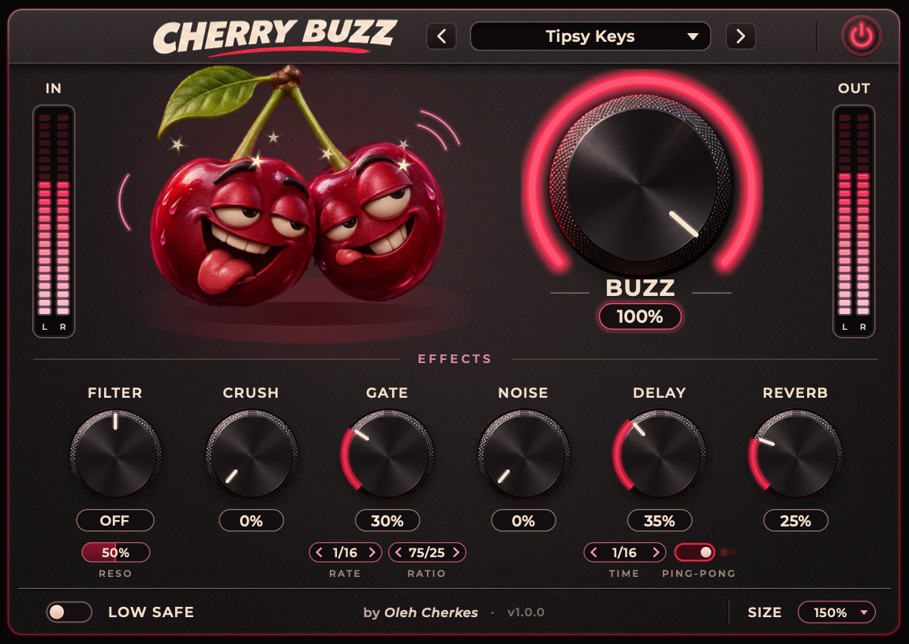
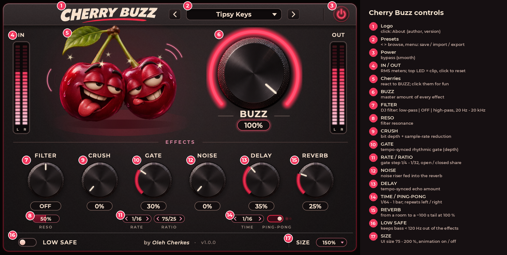

# Cherry Buzz

Free audio effect plugin.



## About

Cherry Buzz is a tempo-synced multi-effect: a DJ filter, bit crusher, rhythmic
gate, noise riser, ping-pong delay and a huge reverb, all driven by one big
**BUZZ** knob. Set up the effects once, then automate BUZZ alone to build a
whole transition: sweeps, risers and build-ups before a drop, lo-fi and
stutter textures, or a long ambient space under vocals, keys and pads. The
gate and the delay follow your song's tempo, and the plugin adds no latency.

## Controls



| Control | Description |
|---|---|
| **BUZZ** | Master amount of every effect. 0 % = dry (bit-exact), 100 % = each effect exactly at its own knob. Automate BUZZ to fade the whole chain in and out at once. |
| **FILTER** | 24 dB/oct DJ filter. Left of centre: low-pass from 20 kHz down to 20 Hz; centre: off; right: high-pass from 20 Hz up to 20 kHz. The cutoff is shown under the knob. |
| **RESO** | Filter resonance (emphasis at the cutoff). |
| **CRUSH** | Lo-fi: fewer bits (down to 4) and a lower sample rate (down to 1/16). |
| **GATE** | Rhythmic, tempo-synced gate; the knob sets its depth (100 % = full silence between steps). |
| **RATE** | Gate step: 1/4, 1/8, 1/16 or 1/32 note. |
| **RATIO** | How much of each gate step is open, from 10/90 (short stabs) to 90/10 (short gaps). |
| **NOISE** | Noise riser: an airy noise wash fed into the reverb. Turning it up (or BUZZ) makes it both louder and brighter. |
| **DELAY** | Tempo-synced echo: adds the level and the number of repeats. |
| **TIME** | Delay time: 1/64, 1/32, 1/16, 1/8, 1/4, 1/2 note or 1 bar. |
| **PING-PONG** | On: repeats bounce left / right. Off: repeats stay in both channels. |
| **REVERB** | Deep space with audible early echoes, from a room (~1.6 s at 30 %) to a ~100 s tail at 100 %. |
| **LOW SAFE** | Keeps the bass below 120 Hz out of the effects, so kicks and bass stay clean. |
| **Power button** | Bypass, with a smooth crossfade. |
| **Presets** | ‹ › to browse, click the name for the menu: 12 factory presets, Save As, Import, Export, Delete. |
| **IN / OUT** | Input and output level meters (RMS). The top LED lights when a peak exceeds 0 dBFS; click the meter to reset it. |
| **SIZE** | Window size 75–200 %, and an Animation on/off switch. |
| **CHERRY BUZZ logo** | Click it to see the author and the version. |

Tip: a new instance starts at BUZZ 0 %, so it doesn't change the sound until you
raise BUZZ and some effect knobs. The factory presets **Build Up Soft** and
**Build Up Wild** are made for automating BUZZ from 0 to 100 % over 8 or 16 bars.

## Installation

### Windows (Intel / AMD)

1. Download `Cherry-Buzz-v1.0.0-Windows-x64.zip`.
2. Extract the archive.
3. Copy the `Cherry Buzz.vst3` folder into:
   `C:\Program Files\Common Files\VST3\`
4. Restart your DAW and rescan plugins if needed.

### Windows ARM64

1. Download `Cherry-Buzz-v1.0.0-Windows-ARM64.zip`.
2. Extract the archive.
3. Copy the `Cherry Buzz.vst3` folder into:
   `C:\Program Files\Common Files\VST3\`
4. Restart your DAW and rescan plugins if needed.

Use the ARM64 build only with a DAW that runs natively on ARM64. If your DAW
runs as an x64 app on a Windows on ARM PC, use the x64 build.

### macOS (Intel / Apple Silicon)

1. Download `Cherry-Buzz-v1.0.0-macOS-Universal.zip`.
2. Extract the archive.
3. Copy `Cherry Buzz.vst3` into:
   `~/Library/Audio/Plug-Ins/VST3/`
4. For Logic Pro, GarageBand and other Audio Unit hosts, also copy
   `Cherry Buzz.component` into:
   `~/Library/Audio/Plug-Ins/Components/`
5. Restart your DAW.

In Finder, use **Go › Go to Folder…** and paste the path. The plugin appears
under the manufacturer **Cherry**. In FL Studio, run **Options › Manage
plugins › Find installed plugins**.

#### If macOS blocks the plugin

This release is not notarized by Apple, so macOS (Gatekeeper) may refuse to
load a plugin downloaded from the internet. Allow Cherry Buzz only; there is no
need to turn off any system protection:

- open **System Settings › Privacy & Security**, scroll down and click
  **Open Anyway** next to the Cherry Buzz message, then restart your DAW; or
- in Terminal, remove the download flag from the two installed files only:

  ```sh
  xattr -dr com.apple.quarantine ~/Library/Audio/Plug-Ins/VST3/"Cherry Buzz.vst3"
  xattr -dr com.apple.quarantine ~/Library/Audio/Plug-Ins/Components/"Cherry Buzz.component"
  ```

## Compatibility

| System | CPU | Formats |
|---|---|---|
| macOS 10.13+ (Intel), macOS 11+ (Apple Silicon) | Universal binary: x86_64 + arm64 | VST3, AU |
| Windows 10 (1607)+ 64-bit | x64 (Intel / AMD) | VST3 |
| Windows 10 / 11 on ARM | ARM64 (native ARM64 DAWs) | VST3 |

Every release archive is built in Release mode by the project's automated build and
checked before it is published: acceptance tests, a plugin host test, and
[pluginval](https://github.com/Tracktion/pluginval) at strictness 10 (plus `auval` for
the Audio Unit). The macOS build has also been used in FL Studio on an Intel Mac.

Works in any 64-bit VST3 host (FL Studio, Ableton Live, Cubase, Bitwig Studio,
Reaper, Studio One, …) and in Audio Unit hosts on macOS (Logic Pro, GarageBand).
Mono and stereo tracks are supported; latency is 0 samples.

Developed by Oleh Cherkes / Cherry (UA)

## License

Cherry Buzz is freeware: free to download and to use, including for commercial
music. It may not be sold or redistributed in modified form. See
[LICENSE](LICENSE) for the full terms and
[THIRD-PARTY-NOTICES.md](THIRD-PARTY-NOTICES.md) for the open-source components
it contains.

VST is a registered trademark of Steinberg Media Technologies GmbH. Audio Units
is a trademark of Apple Inc.

